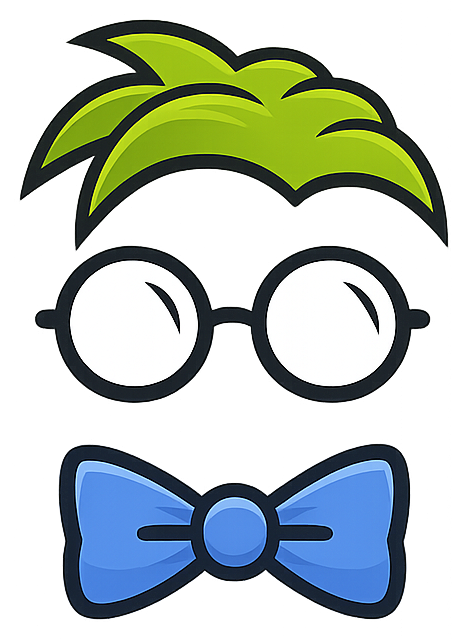

<p align="center">
  
</p>

<h1 align="center">GLAVEN GAME</h1>

<p align="center">
  Digital Gloomhaven board game built with SwiftUI and SpriteKit.<br />
  Hex-grid scenario maps, automated monster AI, interactive player turns,<br />
  attack modifier decks, and full combat resolution — all running natively on Apple platforms.
</p>

---

## What Is This?

GlavenGame is a digital implementation of Gloomhaven (first edition, base game). Players choose ability cards, move their characters on a hex board and fight, while monsters move, focus and attack on their own by Gloomhaven's AI rules. Between scenarios the party is in town: shopping, levelling up, enhancing cards, reading city and road events, and following the campaign across the world map.

**This isn't GlavenApp** (the companion/helper app). GlavenGame is a playable game with a visual hex board, animated piece movement, and automated combat.

The aim is a game that plays exactly as the rulebook, the official FAQ and the scenario book say. Where that work stands, and how it is done, is in [docs/rules-work.md](docs/rules-work.md).

## Features

- **The 95 campaign scenarios** — every map with its rooms, doors, traps, hazards, obstacles and treasure; each scenario's printed goal, losses and special rules (all 95 complete). The scenario book's rules are tracked rule by rule in [docs/scenario-book/rules-audit.md](docs/scenario-book/rules-audit.md)
- **Monster AI** — focus, movement and attacks by the rulebook and FAQ, with pathfinding round walls and closed doors, line of sight, areas, jumps and flight; monster ability decks, shared decks, elements, and the bosses' special rules
- **Player turns** — choose two cards, play a top and a bottom half on the board: moves, attacks, areas you aim, pushes and pulls, loot, summons, persistent bonuses, elements, items, rests and the losing of cards to negate damage
- **Summons and allies** — summons act on their owner's initiative with the owner's modifier deck; escorts and objectives walk to their goals, captives can be saved
- **Combat** — attack modifier decks with Bless and Curse, advantage and disadvantage, Shield, Pierce, Retaliate and every condition
- **The campaign** — town with the shop, the Enhancer, the sanctuary, city and road events, travelling on without returning to Gloomhaven, levelling up, perks, personal quests, retirement and class unlocks, battle goals, prosperity, reputation and achievements on the world map; several campaigns, each saved to its own file
- **Random dungeons** — the random dungeon deck's twenty rooms and twenty monster cards: three rooms drawn by the deck's rules, A and B exits, treasures, and every room's penalties
- **Table rules and learning** — variants a group can play by, solo play, a learning mode that explains what is happening, undo outside the board
- **Sound, accessibility and theming** — sound effects for the board, VoiceOver on the board and in the menus, light and dark mode, the cards as printed scans or drawn in plain type at the size you choose

The data of Frosthaven and Jaws of the Lion is bundled from Gloomhaven Secretariat, but only Gloomhaven can be played.

## Requirements

- macOS 14+ (Sonoma) or iPadOS 17+
- Xcode 16+ (the project builds in Swift 5.10 mode)
- [xcodegen](https://github.com/yonaskolb/XcodeGen) (for Xcode project generation)

## Building and Running

### Swift Package Manager (command line)

```sh
swift build
```

### Xcode (recommended for iPad development)

```sh
# Regenerate the Xcode project from project.yml
xcodegen generate

# Open in Xcode, select a scheme, pick a simulator, Cmd+R
open GlavenGame.xcodeproj
```

The Xcode project is generated by xcodegen and excluded from version control. Run `xcodegen generate` after adding or removing source files.

## Project Structure

```
GlavenGame/
  GlavenGame.swift             # App entry point
  ContentView.swift            # Root navigation
  Board/                       # Board UI and turn execution
    BoardCoordinator.swift     # Bridges SpriteKit scene ↔ SwiftUI state; the turn loop
    BoardCoordinator+*.swift   # Rules by subject: combat, movement, goals, locks, effects, bosses…
    BoardScene.swift           # SpriteKit hex grid rendering and animations
    BoardView.swift            # SwiftUI overlay (character panel, HUD, turn UI)
    PlayerTurnController.swift # Interactive player turn execution
    MonsterTurnController.swift# Automated monster turn execution
    SummonTurnController.swift # Automated summon turn execution
  Engine/                      # Game logic and AI (no UI dependencies)
    MonsterAI.swift            # Gloomhaven monster focus/movement/attack AI
    SummonAI.swift             # Summon AI (inverted friend/foe monster AI)
    CombatResolver.swift       # Attack resolution with modifiers and conditions
    BoardState.swift           # Hex grid state (cells, pieces, doors, walls, overlays)
    BoardBuilder.swift         # Constructs board from scenario map data
    Pathfinder.swift           # Hex grid A* pathfinding
    LineOfSight.swift          # Hex-based line of sight
    HexCoord.swift / HexCell.swift / PieceID.swift
  Managers/                    # Game state orchestration (rounds, scenarios, campaign, events)
  Models/                      # Data models, enums, protocols
  Views/                       # SwiftUI views (setup, town, menus, dialogs)
  Utilities/                   # Image loading, fonts, sound, theming
  Resources/
    EditionData/{gh,fh,jotl}/  # Bundled JSON game data
    ScenarioMaps/              # Hex map data for scenarios; placements/ written from the scenario book
    Fonts/ Images/ Sounds/
Tests/                         # XCTest suite, scenario simulator, golden transcripts
docs/                          # Rules work, rulebook checklist, scenario book notes, audits
scripts/                       # Mutation runner, scenario book helpers
Package.swift                  # SPM package definition
project.yml                    # xcodegen project spec
```

## Testing

```sh
swift test
```

The suite plays the rules through the real board on shared fixtures, plays every scenario to its end with a simulated party, and compares seeded games with hand-checked transcripts. [TESTING.md](TESTING.md) says what there is and how to run each part.

## Copyright / License

Gloomhaven and all related properties, images and text are owned by [Cephalofair Games](https://cephalofair.com).

Assets/Data used:

- [Creator Pack by Isaac Childres](https://boardgamegeek.com/thread/1733586/files-creation) CC BY-NC-SA 4.0
- [Worldhaven](https://github.com/any2cards/worldhaven)
- [Nerdhaven Images](https://drive.google.com/drive/folders/16wSfzvrSlpbGY8l4eWn8dnHjDUF7A2_e)
- [X-haven Assistant](https://github.com/Tarmslitaren/FrosthavenAssistant)
- [Gloomhaven Item DB](https://github.com/heisch/gloomhaven-item-db)
- [Virtual Gloomhaven Board](https://github.com/PurpleKingdomGames/virtual-gloomhaven-board)
