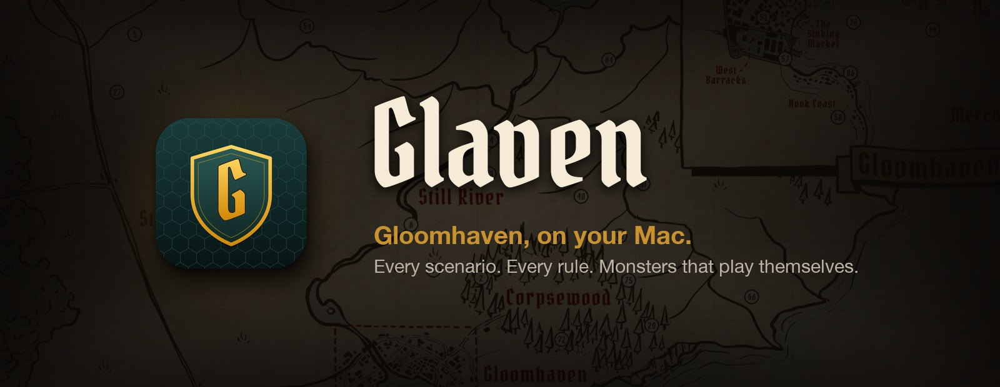
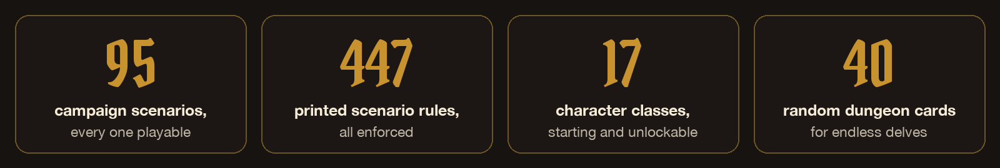
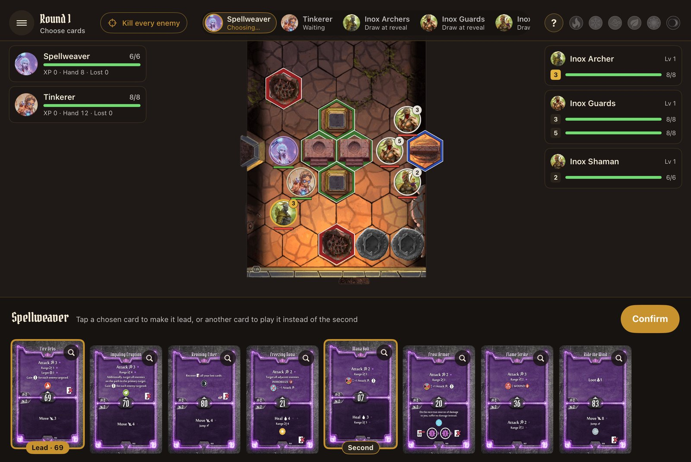
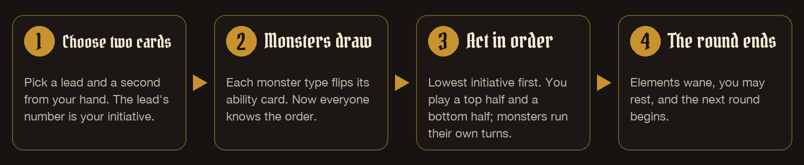
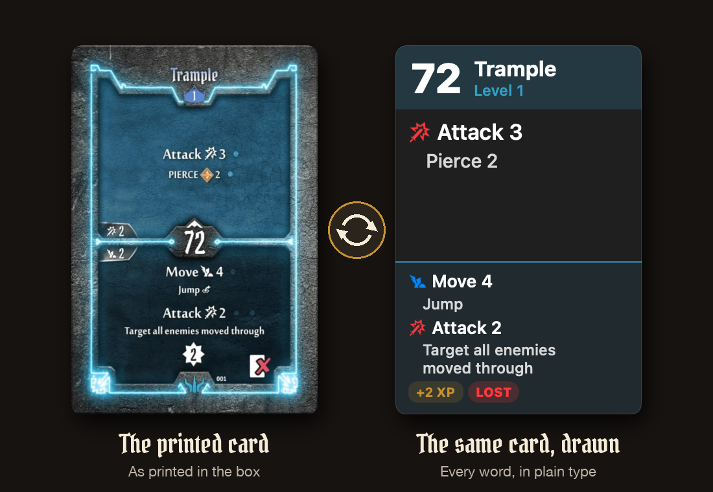
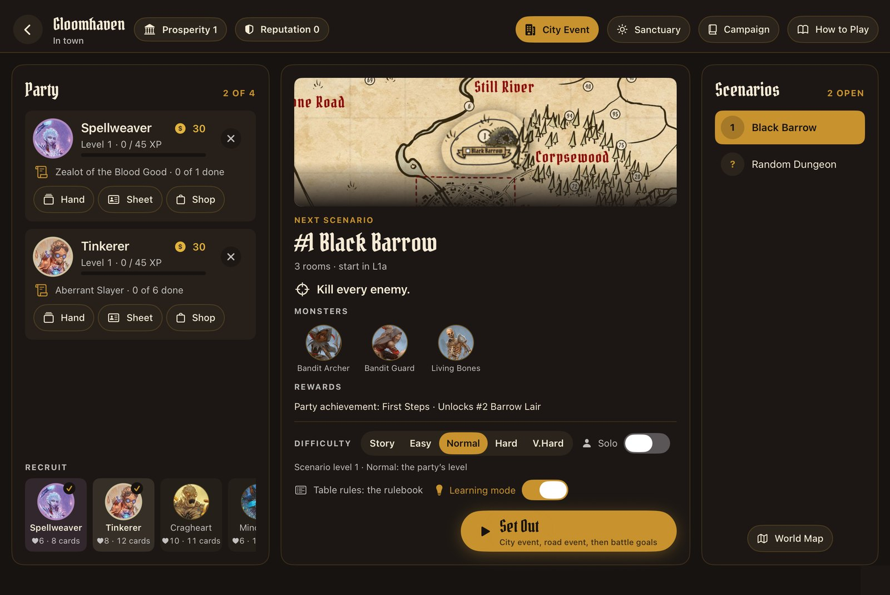

<p align="center">
  
</p>

<p align="center">
  <a href="https://github.com/maxcwolf/glaven-game/releases/latest"><b>Download for Mac</b></a>
  &nbsp;·&nbsp;
  <a href="#what-you-get">What you get</a>
  &nbsp;·&nbsp;
  <a href="#build-it-yourself">Build it yourself</a>
</p>

<p align="center"><sub>An unofficial, fan-made digital edition of <i>Gloomhaven</i>. Not affiliated with Cephalofair Games.</sub></p>

---

**Glaven is Gloomhaven, the whole campaign, played on your screen.** Set up a party, walk into the Black Barrow, and play it the way the box plays: two ability cards a round, a hand that runs out, and monsters that decide for themselves who to hunt. Glaven runs the monsters, does the bookkeeping, and follows the rulebook, the official FAQ and the scenario book to the letter. All you do is make the choices.

<p align="center">
  
</p>

## On the board

<p align="center">
  
</p>

Choose your two cards from the real cards, scanned from the box, and watch the round play out. Move and attack by tapping hexes and figures, aim area attacks, and push, pull, loot and summon. Monsters flip their ability cards and pick their focus, path and targets by Gloomhaven's AI rules. Not sure why one went for you? With learning mode on, tap **Why?** and it tells you.

<p align="center">
  
</p>

- **Every scenario as the book prints it.** Objectives, escorts, pressure plates, locked doors, rising water, rolling boulders, and bosses with their own rules. All 95 campaign scenarios play with every one of their special rules.
- **Combat that keeps itself honest.** Attack modifier decks with Bless and Curse, advantage, Shield, Pierce, Retaliate and every condition. It also counts line of sight and range around walls, exactly as the FAQ says.
- **Your choices stay yours.** Lose a card to spare a captive, give up an action to loot, pick the element for an "any element" bonus, decide which shield takes the hit.

## Cards you can read

<p align="center">
  
</p>

Play with the printed cards, or switch to drawn cards that spell out everything the card says in plain type. Turn a magnified card to see it the other way, and size your hand up when the text is small. You can change both mid-scenario from the game menu.

## Between scenarios

<p align="center">
  
</p>

The campaign carries on in town.

- **In Gloomhaven:** shop at the city's prices, level up with a new card and a perk, and enhance your cards. Visit the Sanctuary, and read city events.
- **On the road:** take road events, or travel straight on to the next scenario.
- **Your characters:** follow personal quests, keep battle goals, retire, and unlock new classes.
- **The world map:** watch it fill in as the party finds new places.
- **Saves:** keep several campaigns side by side.

## What you get

- **The full Gloomhaven campaign:** 95 scenarios and 17 classes, each with its own cards and perks.
- **Random dungeons:** three rooms drawn from the random dungeon deck, set up as you open each door, at the penalty level you choose.
- **A learning mode:** tips that explain what's happening the first time it happens, an illustrated How to Play, and a **?** that explains anything you tap.
- **Table rules and solo play:** the variants a group can play by.
- **Sound, VoiceOver and larger text** throughout, and a choice of app icons.

## Download

Get the latest **[Glaven for Mac](https://github.com/maxcwolf/glaven-game/releases/latest)**: open the DMG and drag Glaven to Applications. It's signed and notarized, and runs on macOS 14 Sonoma or later, on Apple silicon and Intel.

Glaven also runs on iPad (iPadOS 17 or later) if you build it yourself.

## Build it yourself

You'll need Xcode 16 and [xcodegen](https://github.com/yonaskolb/XcodeGen).

```sh
xcodegen generate          # the Xcode project is generated from project.yml
open GlavenGame.xcodeproj  # pick a Mac or iPad destination, then Run
```

`swift build` and `swift test` work from the command line too.

- **[TESTING.md](TESTING.md):** the test suite. Every scenario is played to its end by a simulated party, and every rule is proved with a test.
- **[docs/rules-work.md](docs/rules-work.md):** how the rules are checked against the rulebook, the FAQ and the scenario book.

## Credits

*Gloomhaven* and all related properties, images and text are owned by [Cephalofair Games](https://cephalofair.com). Glaven is an unofficial fan project and isn't endorsed by them. If you enjoy it, [buy the board game](https://cephalofair.com/pages/gloomhaven).

Glaven's code is licensed under the [AGPL-3.0](LICENSE). It is built with these assets and data:

- [Creator Pack by Isaac Childres](https://boardgamegeek.com/thread/1733586/files-creation), CC BY-NC-SA 4.0
- [Worldhaven](https://github.com/any2cards/worldhaven)
- [Nerdhaven Images](https://drive.google.com/drive/folders/16wSfzvrSlpbGY8l4eWn8dnHjDUF7A2_e)
- [X-haven Assistant](https://github.com/Tarmslitaren/FrosthavenAssistant)
- [Gloomhaven Item DB](https://github.com/heisch/gloomhaven-item-db)
- [Virtual Gloomhaven Board](https://github.com/PurpleKingdomGames/virtual-gloomhaven-board)
